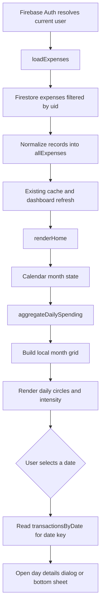
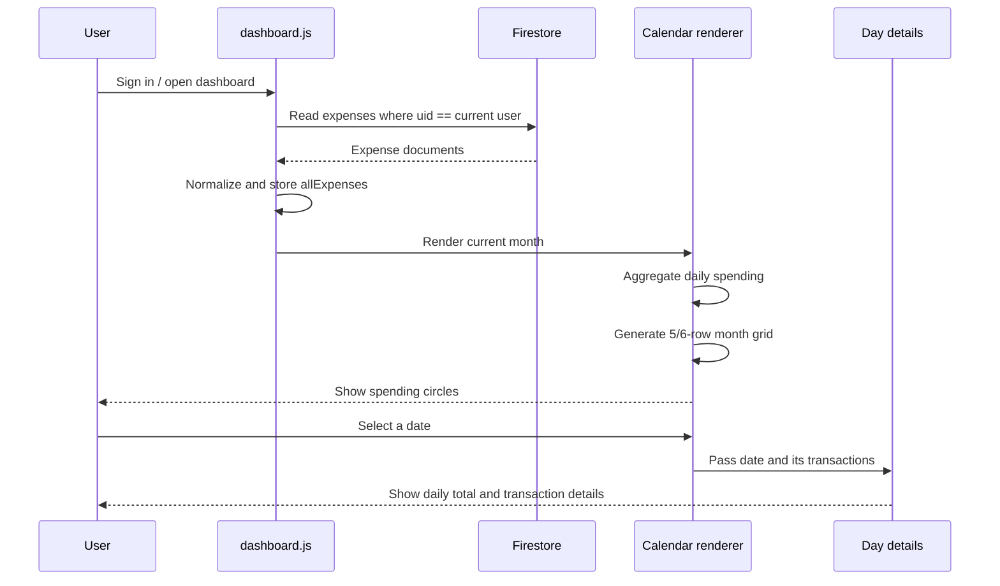

# SpendWise — Daily Spending Calendar / Heatmap
## Feature architecture and implementation guide

**Repository:** https://github.com/shuvrasankha/spendwise  
**Branch reviewed:** `main`  
**Feature:** Monthly daily-spending calendar with proportional circles, intensity colors, month navigation, and selected-day transaction details.  
**Status:** Implementation blueprint; no application source files have been modified.

---

## 1. Feature summary

Add a **Daily Spending Calendar** to the existing SpendWise dashboard.

The calendar displays one month at a time. Every date is represented by a circular marker:

- No spending: neutral/empty date marker.
- Low spending: small, subtle circle.
- Higher spending: progressively larger and more intense circle.
- Highest-spending days: largest/highest-intensity circle.
- Selecting a date opens a dialog or bottom sheet showing that day's total and its individual expense transactions.

Example: if 1 November has ₹1,000 of spending and 2 November has ₹200, the 1 November marker should be visibly larger and more intense.

This is a visualization of recorded spending, not a scheduling calendar. Do not create calendar events or a new transaction type.

## 2. Existing repository architecture relevant to this feature

The repository is a static, vanilla-JavaScript application using Firebase Authentication and Cloud Firestore. The dashboard page is `index.html`; its principal dashboard logic is in `assets/js/dashboard.js`.

Relevant existing architecture:

1. Firebase authentication identifies the current user.
2. `loadExpenses()` reads the signed-in user's records from the `expenses` collection using a `uid` filter.
3. Records are normalized into the in-memory `allExpenses` array.
4. Expense data is cached in session storage and refreshed from Firestore.
5. Dashboard rendering functions consume `allExpenses`.
6. `renderHome()` updates the dashboard's home content.
7. `updateCards()` calls `renderHome()` after expense data changes.
8. The existing `isSpending()` helper distinguishes spending from savings/investment entries.

### Existing expense data shape

The dashboard's expense loader maps Firestore records into objects containing, among other fields:

```js
{
  id,
  uid,
  amount,
  category,
  date,
  payment,
  cardName,
  description,
  notes
}
```

Treat `date` as the existing local-calendar `YYYY-MM-DD` date string. Do not convert date-only strings through UTC timestamps.

### Existing spending rule

`assets/js/utils/helpers.js` exports:

```js
export const isSpending = e =>
  normalizeCategory(e.category) !== 'Savings & Investments';
```

Reuse this helper. Do not independently redefine what counts as spending in the calendar. This keeps the calendar aligned with SpendWise's existing expenditure totals.

### Existing date helpers

`assets/js/utils/helpers.js` exports `pad()` and `todayStr()`. `todayStr()` deliberately uses local year/month/day rather than `toISOString()`, avoiding off-by-one dates in time zones such as India (UTC+5:30).

Use local date components for calendar calculations. Avoid parsing `YYYY-MM-DD` with `new Date(dateString)` where local date behavior could shift the day.

---

## 3. UX and placement

### Recommended dashboard placement

Add the calendar as a new dashboard section directly after the existing **Today** section and before the lower dashboard tiles / other secondary dashboard content.

The existing dashboard has:
- Monthly hero (`.home-hero`)
- Today section (`.home-today`)
- Due-this-month section (`.home-due`)
- Dashboard tiles (`.home-tiles`)

Recommended placement:

```text
Dashboard
├── Monthly spending hero
├── Today summary and today's transactions
├── Daily Spending Calendar        <-- NEW
│   ├── Month heading and navigation
│   ├── Month spending summary
│   ├── Weekday labels
│   ├── 5/6-row month grid
│   ├── Spending intensity legend
│   └── Selected-day details dialog
├── Due this month
└── Dashboard tiles and remaining content
```

Keep it visually consistent with the existing dark/light theme, surface colors, borders, spacing, typography, and gold accent. Avoid introducing a new UI framework or calendar dependency.

### Calendar header

Include:
- Title: `Spending calendar`
- Previous-month button
- Current displayed month and year
- Next-month button
- Optional `Today` shortcut when viewing another month
- Total spending for the displayed month

The next-month button should be disabled when the displayed month is the current month. Do not display future dates as if they have actual spending.

### Grid

- Seven columns, Monday through Sunday (or follow one consistent locale convention; Monday-first is recommended).
- Include leading and trailing blank cells so dates align correctly.
- Display every date in the month.
- Use a circular marker inside each date cell.
- Show the day number clearly, including when the marker is large.
- Use a visible outline or ring for today.
- Distinguish the selected date from today.
- Dates with no spending remain easy to identify and should still be selectable if showing an empty-day state is useful.
- Use responsive CSS Grid; do not use fixed pixel widths that overflow on phones.

### Circle size and color

The marker's size and color should both communicate spending intensity. Color must not be the only signal.

Recommended approach:
- Aggregate the month's spending first.
- Determine the maximum daily total in that month.
- Map each positive daily amount to a bounded size range (for example, 18–38 CSS pixels).
- Map the same normalized value to 4–5 color-intensity levels using theme-aware CSS classes or CSS custom properties.
- Keep a minimum size difference between meaningful levels.
- Use a neutral marker for zero-spend days.
- Avoid letting one extreme day make every other marker almost identical. Consider a square-root or logarithmic normalization, or use month-relative quantile buckets.
- Do not hardcode rupee thresholds: the user's currency and spending habits may vary.

A simple normalized size formula is:

```js
const ratio = maxDailySpend > 0 ? amount / maxDailySpend : 0;
const sizeRatio = Math.sqrt(ratio);
const diameter = MIN_DIAMETER +
  sizeRatio * (MAX_DIAMETER - MIN_DIAMETER);
```

Clamp the result to the configured minimum and maximum. For intensity colors, use month-relative thresholds (for example quartiles among positive daily totals), with sensible handling when there are fewer than four distinct values.

### Selected-day interaction

Clicking/tapping a date opens a dialog on desktop and a bottom sheet on mobile if that matches the app's existing modal conventions.

The detail view should contain:
- Full selected date (for example, Sunday, 1 November 2026)
- Total amount spent that day
- Number of spending transactions
- Individual transactions, each with category/icon, description, payment method and amount
- Notes when present, if space allows
- Empty state for a day with no spending
- Close button and Escape-key behavior

Use the app's existing transaction formatting and category icon conventions where practical. Do not create duplicate transactions or write anything to Firestore when a date is selected.

---

## 4. Data and calculation design

### Input

Use the existing `allExpenses` array in `dashboard.js`. Do not issue a second Firestore query for the calendar.

### Aggregation function

Implement a small pure function (in `dashboard.js` initially, or a focused utility module if the project conventions support it):

```js
function aggregateDailySpending(expenses, year, monthIndex) {
  const totals = new Map();
  const transactionsByDate = new Map();

  for (const expense of expenses) {
    if (!expense.date || !isSpending(expense)) continue;

    // Compare the canonical local-calendar date string.
    const [yearPart, monthPart] = expense.date.split('-');
    if (
      Number(yearPart) !== year ||
      Number(monthPart) !== monthIndex + 1
    ) continue;

    const amount = Number(expense.amount);
    if (!Number.isFinite(amount) || amount <= 0) continue;

    const dateKey = expense.date;
    totals.set(dateKey, (totals.get(dateKey) || 0) + amount);

    if (!transactionsByDate.has(dateKey)) {
      transactionsByDate.set(dateKey, []);
    }
    transactionsByDate.get(dateKey).push(expense);
  }

  return { totals, transactionsByDate };
}
```

The example is a starting point, not a drop-in guarantee. Confirm whether the app's `isSpending()` and amount conventions need any additional treatment before merging.

### Important financial correctness rules

1. Only include expenses for the displayed month.
2. Only include entries for which `isSpending(expense)` returns true.
3. Exclude zero, negative, `NaN`, and non-finite amounts from the visual spending sum unless the product has a separately defined refund/adjustment convention. Confirm refund behavior before implementing it.
4. Group by the stored `YYYY-MM-DD` value; do not derive the date from `createdAt`.
5. A transaction edited to another date must move to the new date after the existing expense update flow refreshes the calendar.
6. A deleted transaction must disappear from the selected-day details and daily total.
7. Pending offline transactions already present in `allExpenses` should appear consistently with the dashboard's existing offline behavior. Consider a small “Waiting to sync” label in details for `pending` records.
8. Savings/investment category entries must be excluded in line with the existing `isSpending()` rule.
9. Use the existing currency formatting helpers (`fmt`, `moneyWhole`, or the appropriate formatter) instead of hardcoding `₹`.
10. Do not calculate the monthly total from the calendar and then use it to replace the existing dashboard total. The calendar is an additional view and should agree with existing totals.

### Month grid calculation

Use local date components and a stable date key:

```js
function makeDateKey(year, monthIndex, day) {
  return `${year}-${String(monthIndex + 1).padStart(2, '0')}-${String(day).padStart(2, '0')}`;
}
```

For a Monday-first calendar:

```js
const firstDay = new Date(year, monthIndex, 1);
const daysInMonth = new Date(year, monthIndex + 1, 0).getDate();
const leadingBlanks = (firstDay.getDay() + 6) % 7;
const totalCells = Math.ceil((leadingBlanks + daysInMonth) / 7) * 7;
```

Generate `totalCells` cells. A cell is either a blank placeholder or a real day with its date key and daily total.

Do not use a fixed 35-cell grid: some months require six rows.

---

## 5. Proposed rendering and interaction flow



### Refresh points

The calendar must refresh whenever the dashboard's expense data changes. Integrate it with the existing rendering lifecycle rather than creating a second source of truth.

Review these existing paths:
- Initial render from session cache after authentication.
- Firestore refresh in `loadExpenses()`.
- `updateCards()` / `renderHome()`.
- Add-expense success and offline-queue paths.
- Expense edit success.
- Expense deletion success.
- Dashboard navigation back to the dashboard.

Prefer a single calendar render function called by `renderHome()` or a clearly coordinated dashboard render function. Avoid redundant Firestore reads and avoid rendering before the calendar DOM exists.

### Month navigation state

Maintain a small state object:

```js
let calendarYear;
let calendarMonthIndex;
let selectedCalendarDate = null;
```

Initialize the visible month to the user's current local month. Previous/next month buttons update this state and rerender only the calendar. A `Today` shortcut resets it to the current local month.

Do not mutate `allExpenses` when changing months.

---

## 6. Suggested implementation boundaries

These are the likely files to change based on the repository structure inspected. Confirm the current branch before editing because line numbers and surrounding markup can change.

### `index.html`

Add semantic calendar markup inside `#page-dashboard`, after the existing Today section.

Suggested IDs (adapt to naming conventions if needed):

```html
<section class="home-section spending-calendar"
         id="spending-calendar"
         aria-labelledby="spending-calendar-title">
  <div class="calendar-header">
    <div>
      <h3 id="spending-calendar-title">Spending calendar</h3>
      <p id="calendar-month-total"></p>
    </div>

    <div class="calendar-month-controls">
      <button type="button" id="calendar-prev-month"
              aria-label="Previous month">...</button>
      <span id="calendar-month-label"></span>
      <button type="button" id="calendar-next-month"
              aria-label="Next month">...</button>
    </div>
  </div>

  <div class="calendar-weekdays" aria-hidden="true">
    <!-- seven weekday labels -->
  </div>

  <div class="calendar-grid" id="calendar-grid"
       role="group" aria-label="Daily spending calendar"></div>

  <div class="calendar-legend" id="calendar-legend">
    <!-- low-to-high intensity explanation -->
  </div>
</section>

<!-- Add a dedicated accessible dialog or reuse the existing
     modal/bottom-sheet pattern after inspecting its conventions. -->
```

Do not paste the ellipses as implementation. Use the project's existing Lucide icon conventions and proper button markup.

### `assets/js/dashboard.js`

Responsibilities:
- Calendar month state.
- Daily aggregation from `allExpenses`.
- Month-grid generation.
- Circle intensity and size calculation.
- Rendering accessible date buttons.
- Month navigation handlers.
- Selected-day detail rendering.
- Refresh integration with `renderHome()`.

Reuse existing:
- `allExpenses`
- `isSpending`
- `todayStr`
- `fmt` / `moneyWhole`
- `normalizeCategory`
- `CATEGORY_ICONS` (if in scope)
- `escapeHtml` for any user-provided text inserted into HTML

Prefer DOM APIs and `textContent` for user-controlled descriptions/notes. If using `innerHTML`, escape every user-controlled string. Do not interpolate raw notes or descriptions into HTML.

### `assets/css/style.css`

Add calendar-specific classes, including:
- `.spending-calendar`
- `.calendar-header`
- `.calendar-month-controls`
- `.calendar-weekdays`
- `.calendar-grid`
- `.calendar-day`
- `.calendar-day-marker`
- `.calendar-day-number`
- `.calendar-day--today`
- `.calendar-day--selected`
- `.calendar-intensity-*`
- `.calendar-legend`
- `.calendar-day-dialog` or the existing modal class names

Use existing design tokens (`--surface`, `--border`, `--text`, `--text2`, `--accent`, etc.) rather than hardcoded theme colors where possible. Add dark and light theme behavior through the existing token system.

### `assets/css/responsive.css`

Verify:
- Seven columns fit at narrow mobile widths.
- Touch targets are sufficiently large (ideally 44px).
- Month label and navigation do not collide.
- Details sheet fits the viewport and scrolls internally if needed.
- No horizontal page overflow.
- Circle size remains bounded on small screens.

### Tests

The repository README documents Node's test command as:

```bash
node --test tests/*.test.mjs
```

Add tests using the repository's existing test style. Keep aggregation and date-grid logic pure so it can be tested without a browser or Firebase.

---

## 7. Detailed test plan

### Aggregation tests

- One transaction on a day produces the expected daily total.
- Multiple transactions on the same date are summed.
- Transactions on different dates remain separate.
- Transactions outside the displayed month are excluded.
- Savings & Investments entries are excluded by `isSpending()`.
- Invalid, zero, negative and non-finite amounts do not create positive spending markers.
- Empty expense list returns empty maps.
- Category aliases continue to be handled by the shared helper.

### Calendar layout tests

- Month beginning Monday has zero leading blank cells.
- Month beginning Sunday has six leading blank cells in Monday-first layout.
- 28-, 29-, 30- and 31-day months render correctly.
- Months needing six rows render 42 cells.
- Leap-year February has 29 days.
- Month navigation handles January/December year boundaries.
- Future dates in the current month do not show fabricated transactions.

### Interaction tests

- Selecting a date opens the correct detail view.
- Selected-day total equals the sum of displayed spending transactions.
- Empty date shows a useful empty state.
- Previous/next month updates the grid and monthly total.
- Today shortcut returns to the current month.
- Escape and close button dismiss the detail view.
- Keyboard users can focus and activate dates.
- Clicking month controls does not accidentally select a date.

### Data lifecycle tests

- Cached expenses can render the calendar before Firestore's silent refresh.
- Firestore refresh updates totals.
- Adding an expense updates the calendar.
- Editing an expense amount updates the marker size/intensity.
- Editing an expense date moves it to the correct day.
- Deleting an expense updates the date and monthly total.
- Pending offline transactions are handled consistently.
- A different signed-in user never sees another user's records.

### Visual/regression tests

- Dark theme and light theme.
- Desktop, tablet and mobile.
- Long descriptions and notes in details.
- Very large daily totals.
- Months with no spending.
- Month with one transaction only.
- Large number of transactions on a single date.

---

## 8. Performance and maintainability

- Do not query Firestore once per calendar date.
- Do not create one listener per day.
- Aggregate in one pass over `allExpenses` for the displayed month.
- Use a `Map` keyed by date for O(n) aggregation.
- Render at most 42 calendar cells.
- Re-render the calendar only when relevant expense data or visible month changes.
- Avoid rebuilding unrelated dashboard charts when only the calendar month changes.
- Keep calendar calculations independent of the DOM where practical.
- Do not add a third-party calendar package for this relatively small custom visualization.

---

## 9. Accessibility requirements

- Use real `<button>` elements for dates and month controls.
- Provide each date button an accessible label containing the date and total (for example, “1 November 2026, ₹1,000 spent”).
- Do not communicate spending intensity using color alone; include amount in the accessible label and selected-day details.
- Provide visible keyboard focus styles.
- Mark the current date with an accessible indication.
- Give the details dialog an accessible title and appropriate dialog semantics.
- Move focus into the dialog when opened and restore focus to the selected date button when closed.
- Support Escape to close.
- Ensure text and markers meet contrast requirements in both themes.

---

## 10. Acceptance criteria

The feature is complete when:

- [ ] A monthly spending calendar appears on the dashboard in the intended position.
- [ ] It opens on the current local month.
- [ ] Previous and next month navigation works, including year boundaries.
- [ ] Every date aligns to the correct weekday.
- [ ] Spending days show circles whose size and color represent daily spending.
- [ ] Empty days are visually distinct from spending days.
- [ ] Daily totals use the user's selected currency formatter.
- [ ] Selecting a date displays all spending transactions for that date.
- [ ] Calendar totals agree with existing dashboard spending rules.
- [ ] Savings/investment entries are excluded.
- [ ] Adding, editing, deleting and syncing expenses refreshes the calendar.
- [ ] No new Firestore collection, backend endpoint or database migration is introduced.
- [ ] The feature works in dark mode, light mode and mobile layouts.
- [ ] Tests pass with the repository's documented test command.
- [ ] No existing dashboard, expense, history or offline behavior regresses.

---

## 11. Implementation sequence for an AI coding agent

1. Re-read the current `main` branch and inspect the current dashboard markup, modal conventions, CSS tokens, responsive styles, category icon map, and expense tests.
2. Confirm the current expense object shape and all expense add/edit/delete refresh paths.
3. Implement and test pure daily aggregation and month-grid functions.
4. Add the dashboard calendar markup.
5. Add calendar state, rendering, and month navigation.
6. Add accessible selected-day details using existing modal/bottom-sheet conventions.
7. Add theme-aware styles and responsive behavior.
8. Connect calendar refresh to the existing dashboard lifecycle.
9. Add unit tests and run all existing application tests.
10. Manually verify desktop/mobile, dark/light themes, offline pending records, edit/delete behavior, and month/year boundaries.
11. Summarize changed files, design decisions, test results, and any remaining limitations.

## 12. Mermaid sequence diagram



## 13. Important implementation notes

- This guide is based on the publicly visible `main` branch at the time of review. Re-check the branch before implementation.
- The proposed file list is grounded in the existing repository structure, but exact insertion points and modal reuse should be confirmed against the current code before editing.
- The UI design is a recommendation, not an existing component.
- No database schema changes are expected.
- The app's current spending definition should remain the source of truth.
